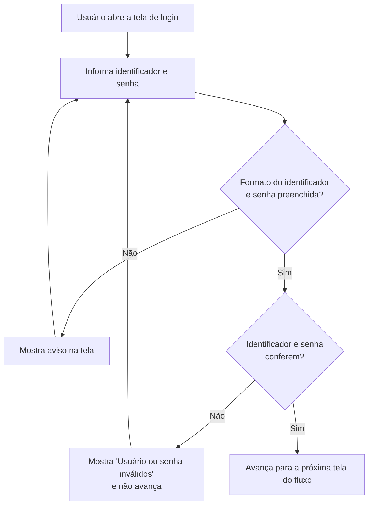

# Regras da Tela de Login

## 1. Objetivo

Definir como a tela de login funciona: quais identificadores o usuário pode usar, como cada campo é validado e quando o usuário pode avançar no fluxo.

## 2. Campos da tela

| Campo | Obrigatório | Descrição |
|---|---|---|
| **Identificador** | Sim | Número de **celular**, número de **telefone fixo** ou **e-mail** |
| **Senha** | Sim | Senha cadastrada para o usuário |

> O usuário pode entrar com **qualquer uma** das três opções de identificador. Todas são válidas.

## 3. Validação de formato (na tela)

Antes de enviar, a tela verifica se o identificador está em um formato válido. Se não estiver, o sistema **mostra um aviso na própria tela**, junto ao campo.

### 3.1 Formatos aceitos

| Tipo | Regra de formato | Exemplo válido |
|---|---|---|
| **Celular** | DDD (2 dígitos) + 9 dígitos, começando com 9 | `(11) 91234-5678` / `11912345678` |
| **Telefone fixo** | DDD (2 dígitos) + 8 dígitos, começando de 2 a 5 | `(11) 3123-4567` / `1131234567` |
| **E-mail** | `XXX@XXX.XX` (ver 3.2) | `nome@exemplo.com.br` |

### 3.2 Regra do e-mail (`XXX@XXX.XX`)

O identificador é tratado como e-mail quando contém `@`. Para ser válido, ele precisa ter:

1. **Usuário** antes do `@`, sem espaços (`XXX`).
2. Exatamente **um** `@`.
3. **Domínio** depois do `@`, sem espaços (`XXX`).
4. Pelo menos um **ponto** no domínio, seguido de uma **extensão com no mínimo 2 letras** (`.XX`), ex.: `.com`, `.br`, `.com.br`.

| Exemplo | Válido? | Motivo |
|---|---|---|
| `nome@exemplo.com.br` | ✅ | Segue o formato |
| `nome@exemplo.com` | ✅ | Segue o formato |
| `nomeexemplo.com` | ❌ | Falta o `@` |
| `nome@exemplo` | ❌ | Falta o ponto e a extensão |
| `nome@exemplo.c` | ❌ | Extensão com menos de 2 letras |
| `@exemplo.com` | ❌ | Falta o usuário antes do `@` |
| `nome@@exemplo.com` | ❌ | Mais de um `@` |
| `nome @exemplo.com` | ❌ | Contém espaço |

Se o e-mail não seguir essa regra, a tela **mostra um alerta** abaixo do campo identificador e **não envia** os dados até que ele seja corrigido.

### 3.3 Avisos na tela

| Situação | Mensagem sugerida |
|---|---|
| Identificador vazio | "Informe seu celular, telefone ou e-mail." |
| Celular em formato inválido | "Número de celular inválido. Use DDD + número, ex.: (11) 91234-5678." |
| Telefone em formato inválido | "Número de telefone inválido. Use DDD + número, ex.: (11) 3123-4567." |
| E-mail em formato inválido | "E-mail inválido. Use o formato nome@dominio.com (ex.: nome@exemplo.com.br)." |
| Senha vazia | "Informe sua senha." |

- O botão **Entrar** não envia os dados enquanto houver erro de formato.
- A mensagem de erro aparece logo abaixo do campo com problema.

## 4. Validação das credenciais

Depois que o formato está correto, o sistema confere se o **identificador** e a **senha** pertencem ao mesmo usuário.

| Identificador | Senha | Resultado |
|---|---|---|
| Correto | Correta | ✅ **Permite avançar** para a próxima tela do fluxo |
| Correto | Incorreta | ❌ **Bloqueia** o avanço e mostra mensagem de erro |
| Não cadastrado | Qualquer | ❌ **Bloqueia** o avanço e mostra mensagem de erro |

- Mensagem de erro sugerida: **"Usuário ou senha inválidos."**
- Por segurança, a mensagem **não informa qual dos dois campos está errado**.

## 5. Fluxo resumido

## 6. Critérios de aceite

- [ ] O usuário consegue entrar usando **celular**, **telefone fixo** ou **e-mail**.
- [ ] A senha é obrigatória.
- [ ] Identificador em formato inválido mostra aviso na tela e impede o envio.
- [ ] E-mail fora do formato `XXX@XXX.XX` mostra alerta na tela e impede o envio.
- [ ] Se identificador e senha **não** conferem, o usuário **não avança**.
- [ ] Se identificador e senha conferem, o usuário **avança** para a próxima tela do fluxo.
- [ ] A validação de credenciais acontece no servidor (não só no navegador).
