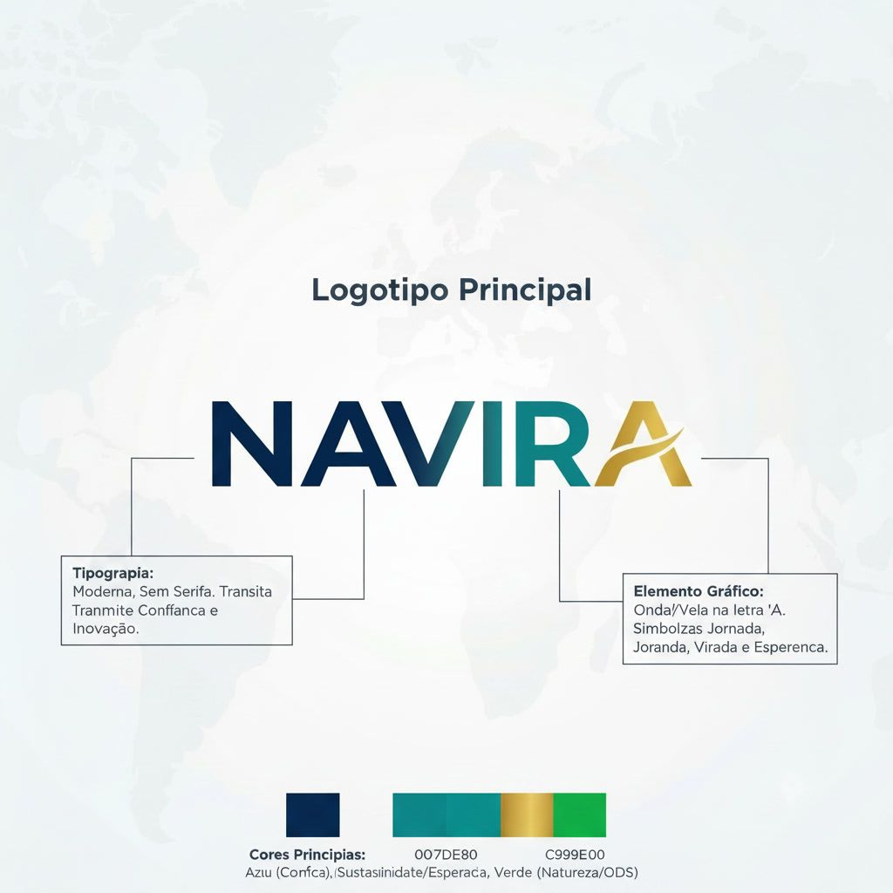

# NAVIRA — Documento consolidado




# Apresentacao-Navira

# NAVIRA
## Brand Presentation

<div align="center">

# NAVIRA

### Identidade visual premium para uma marca com propósito

**Brand strategy · Design system · Direction & application**

---

**Direção executiva da marca**  
**Estratégia visual, posicionamento e consistência institucional**

</div>

---

# Índice

1. [Resumo executivo](#resumo-executivo)
2. [Essência da marca](#essencia-da-marca)
3. [Posicionamento estratégico](#posicionamento-estrategico)
4. [Paleta e tokens](#paleta-e-tokens)
5. [Tipografia e linguagem visual](#tipografia-e-linguagem-visual)
6. [Layout e diagramação](#layout-e-diagramacao)
7. [Design system](#design-system)
8. [Manual de uso da marca](#manual-de-uso-da-marca)
9. [Conclusão](#conclusao)

---

# Estética corporativa premium

A NAVIRA é pensada como uma marca de presença institucional, sofisticada e moderna. Sua estética transmite:

- confiança e autoridade
- sustentabilidade e futuro
- modernidade com refinamento
- clareza visual e percepção premium

> A força da marca não está no excesso, mas na elegância do equilíbrio: clareza, proporção, espaçamento e intenção.

### Direção visual
- linguagem contemporânea
- alinhamento preciso
- composição limpa e sofisticada
- foco em legibilidade e presença
- equilíbrio entre profissionalismo e emoção

---

# Resumo executivo

A NAVIRA foi concebida para representar uma marca com visão de longo prazo: sólida, responsável e progressista. Sua identidade visual reúne três pilares fundamentais: estabilidade, propósito e evolução.

A combinação entre o azul institucional, o verde de crescimento e o dourado premium entrega uma linguagem visual de alta percepção, alinhada a valores de credibilidade, sustentabilidade e refinamento. A marca comunica confiança sem perder sofisticação e modernidade.

O símbolo da onda/traço na letra “A” reforça a ideia de transformação e continuidade, conectando a marca ao conceito de trajetória, avanço e esperança. A linguagem visual apresenta uma leitura premium, funcional e memorável, com forte aplicação em ambientes corporativos, digitais e institucionais.

## Referência de benchmark e contexto estratégico

A análise realizada a partir do documento de benchmark revelou referências relevantes no mercado que reforçam a direção visual proposta para a marca. Os links identificados apontam para uma base de inspiração em comunicação institucional, storytelling e posicionamento digital, com foco na construção de uma presença mais moderna e confiável.

Essas referências contribuem para a definição de uma identidade que busca:

- comunicar autoridade sem rigidez excessiva
- reforçar os valores de visão de futuro e responsabilidade
- manter consistência entre mensagem, linguagem visual e percepção institucional
- construir uma marca com presença digital forte e visualmente memorável

A leitura do benchmark e da paleta visual indica que a NAVIRA deve seguir um caminho visual com base em clareza, equilíbrio e diferenciação emocional, sem perder a elegância e a confiança corporativa.

---

# Essência da marca

## Propósito
A NAVIRA existe para conectar estratégia, impacto e evolução. Sua comunicação deve ser clara, segura e inspiradora, criando uma percepção de marca forte, presente e confiável.

## Valores centrais
- Confiança
- Sustentabilidade
- Evolução
- Transparência
- Qualidade
- Inspiração

## Personalidade da marca
- profissional
- contemporânea
- refinada
- confiável
- aspiracional
- humana

---

# Posicionamento estratégico

A marca NAVIRA deve ser percebida como uma referência de construção, progresso e futuro. Seu posicionamento é institucional, mas não estático: é dinâmico, moderno e alinhado ao desenvolvimento responsável.

A partir das referências analisadas no benchmark, a marca ganha suporte para uma direção que combina posicionamento digital contemporâneo com linguagem corporativa clara. Esse alinhamento favorece a percepção de um negócio que entende comunicação, autoridade e relevância no mercado atual.

### Posicionamento desejado
- Institucional e inovador
- Sustentável e responsável
- Premium, sem ostentação
- Forte, acessível e confiável

### Tom de voz
- claro
- objetivo
- inspirador
- contemporâneo
- profissional

### Insight de benchmark

Os materiais de referência sugerem padrões de comunicação que favorecem:

- clareza na mensagem institucional
- combinação de sustentabilidade com presença premium
- linguagem visual que comunica progresso sem perder confiabilidade
- utilização de potência visual em contexto digital com forte legibilidade

Esse conjunto apoia a ideia de que a NAVIRA deve transmitir uma experiência de marca moderna, sólida e progressista, alinhada à intenção estratégica do negócio.

---

# Paleta e tokens

## Paleta principal

| Token | Nome sugerido | Uso principal | Sentido |
|---|---|---|---|
| `navira-blue-900` | Azul Navira Profundo | logo, fundo institucional | confiança e estabilidade |
| `navira-blue-700` | Azul Navira Médio | destaques e navegação | liderança e profissionalismo |
| `navira-green-600` | Verde Navira | destaques, ícones e ações | sustentabilidade e crescimento |
| `navira-gold-500` | Dourado Premium | elementos refinados | valor e sofisticação |
| `navira-white` | Branco Claro | fundos e suporte visual | clareza e equilíbrio |
| `navira-ink` | Preto Institucional | texto principal | contraste e leitura |

## Significado emocional
- Azul: segurança, inteligência, reputação
- Verde: esperança, responsabilidade, movimento
- Dourado: valor, distinção, refinamento premium

### Tokens estruturados

```yaml
brand:
  colors:
    primaryBlue: "#0B3D5C"
    mediumBlue: "#1F5C7A"
    sustainGreen: "#4BAE9F"
    premiumGold: "#C9A55C"
    white: "#F7F7F5"
    ink: "#1D1D1D"
```

---

# Tipografia e linguagem visual

## Direção tipográfica

A tipografia da marca deve ser:

- moderna
- sem serifa
- limpa
- forte
- altamente legível

## Hierarquia visual
- H1: impacto e presença
- H2: estrutura e clareza de informação
- H3: detalhamento e apoio editorial
- Corpo: leitura confortável em digital e impressos

## Símbolo gráfico

O detalhe em forma de onda/traço na letra “A” representa:

- movimento
- progresso
- transformação
- esperança
- continuidade

Esse elemento funciona como um símbolo de trajetória e evolução, reforçando a narrativa da marca com personalidade e identidade.

---

# Layout e diagramação

## Princípios de composição

A organização visual da NAVIRA deve seguir:

- alinhamento centralizado e simétrico
- espaço em branco como ferramenta de elegância
- hierarquia clara entre marca, texto e suporte visual
- balanceamento entre informação e impacto visual
- modularidade funcional e sofisticada

## Estrutura recomendada
- logo principal em destaque central
- blocos de texto com margens amplas
- fundos limpos e contrastantes
- uso discreto de elementos gráficos
- ritmo visual uniforme e elegante

> A marca precisa parecer premium por composição, não por excesso.

---

# Design system

## Fundamentos do sistema

- consistência visual para qualquer canal
- simplicidade premium
- hierarquia clara
- padronização de cor, espaço e tipografia
- leitura forte em aplicações digitais e impressas

## Componentes sugeridos

### Botões
- primário: azul institucional
- secundário: verde ou branco com contorno azul
- destaque premium: dourado em cenários seletivos

### Cards e blocos
- fundo branco ou muito claro
- linhas delicadas
- conteúdo organizado e receptor visual limpo

### Navegação e menus
- azul como base estrutural
- verde para ações e destaque
- contraste adequado para leitura refinada

### Ícones e gráficos
- estilo plano e minimalista
- formas limpas
- paleta consistente com a identidade oficial

---

# Manual de uso da marca

## Área de proteção

O logotipo deve ser sempre cercado por área de segurança para manter sua legibilidade e presença.

## Variações principais
- logo principal em cores oficiais
- logo monocromático
- logo invertido em fundo escuro

## Regras de uso

### Uso correto
- proporções originais preservadas
- fundos com contraste adequado
- uso atrelado à sistemática visual da marca
- respeito ao espaço livre em torno do logotipo

### Uso incorreto
- deformação do logo
- redução excessiva
- alteração da paleta
- uso sobre fundos carregados
- excesso de elementos gráficos

---

# Conclusão

A NAVIRA é uma marca que une força institucional, estabilidade emocional e propósito estratégico. Seu design comunica confiança, evolução e responsabilidade, com um visual que se adapta ao contexto digital e corporativo sem perder sofisticação.

A identidade visual desenvolvida combina a clareza do azul, o otimismo do verde e a presença premium do dourado, criando uma marca memorável, elegante e moderna. Esse conjunto torna a NAVIRA uma marca profissional, confiável e distinta, com forte potencial de reconhecimento.

---

## Fechamento executivo

A marca NAVIRA deve ser construída sobre três pilares:

1. Confiança institucional
2. Sustentabilidade como valor de marca
3. Evolução constante e presença premium

Com essa base, a identidade visual alcança equilibrio ideal entre credibilidade, relevância e impacto.

---

## Referências internas

- [Brand-Book-Navira.md](Brand-Book-Navira.md)
- [Design-System-Navira.md](Design-System-Navira.md)
- [Guia-de-Identidade-Navira.md](Guia-de-Identidade-Navira.md)
- [Briefing-Cliente-Navira.md](Briefing-Cliente-Navira.md)
- [Manual-Uso-Marca-Navira.md](Manual-Uso-Marca-Navira.md)
- [Benchmark.md](Benchmark.md)
- [Paleta.jpg](Paleta.jpg)

## Fontes de benchmark analisadas

- https://risekit.co/?utm_source=chatgpt.com
- https://usa.generation.org/?utm_source=chatgpt.com
- https://www.youtube.com/watch?v=CUjbOJJTtJM

Essas referências foram incorporadas ao processo de direção de marca como apoio estratégico para definir a linguagem visual, o tom de comunicação e a percepção institucional desejada para a NAVIRA.


---


# Brand-Book-Navira

# Brand Book — NAVIRA

## 1. Introdução

A NAVIRA é uma marca com posicionamento institucional, moderno e sustentável. Sua identidade visual combina confiança corporativa, progresso, simplicidade e sofisticação. A linguagem visual foi pensada para transmitir credibilidade, energia positiva e responsabilidade social, com uma estética contemporânea e premium.

## 2. Essência da marca

### Proposta central
A marca NAVIRA comunica uma empresa que une:

- solidez institucional
- crescimento sustentável
- visão de futuro
- inovação com responsabilidade
- presença moderna e confiável

### Referência de benchmark e contexto estratégico
A análise do benchmark revelou referências relevantes que reforçam a direção visual da marca. Os materiais observados sugerem uma base de inspiração em comunicação institucional, storytelling digital e posicionamento moderno, com foco em credibilidade, presença e clareza.

Essas referências ajudam a sustentar a proposta da NAVIRA como uma marca que combina:

- autoridade institucional sem rigidez excessiva
- linguagem contemporânea e acessível
- sustentabilidade como valor central
- percepção premium sem excesso decorativo
- comunicação visual forte e memorável

### Valores
- Confiança
- Sustentabilidade
- Evolução
- Transparência
- Qualidade
- Inspiração

### Personalidade da marca
- Proativa
- Moderna
- Segura
- Humanizada
- Progressista
- Acessível, mas premium

---

## 3. Posicionamento

A NAVIRA busca ser reconhecida como uma marca que conecta estrutura, propósito e evolução. Sua comunicação deve parecer clara, confiável e inspiradora, sem perder a sofisticação e a elegância.

A leitura do benchmark reforça esse direcionamento: a marca precisa transmitir solidez e progresso ao mesmo tempo, com linguagem visual moderna e presença institucional forte. O objetivo é criar uma identidade que pareça atual, confiável e aspiracional.

### Posicionamento desejado
- Institucional e contemporânea
- Sustentável e responsável
- Forte e acessível
- Premium sem excesso

### Insight do benchmark
- clareza na mensagem institucional
- equilíbrio entre sustentabilidade e presença premium
- comunicação visual confiável e contemporânea
- forte legibilidade em canais digitais e impressos

---

## 4. Público-alvo

A marca pode ser aplicada a:

- clientes corporativos
- stakeholders e parceiros
- público institucional
- comunidade e aliados estratégicos
- audiences que valorizam modernidade e propósito

---

## 5. Direção criativa

### Visão visual
A linguagem visual da NAVIRA deve expressar:

- clareza
- equilíbrio
- movimento
- confiança
- presença sem agressividade

### Simbolismo
O elemento gráfico principal, presente na letra “A”, representa uma onda, trajetória e aceleração de transformação. Esse símbolo reforça a ideia de jornada, oportunidade, avanço e evolução contínua.

---

## 6. Identidade visual

### Logotipo
- Nome: NAVIRA
- Estilo: moderno, robusto, institucional
- Leitura: limpa e forte
- Aplicação: destaque principal em websites, materiais institucionais e apresentações

### Elemento gráfico
- Forma inspirada em onda / linha de movimento
- Relação com a marca: progresso, virada, trajetória e esperança

### Tipografia sugerida
- Modern sans serif
- Geométrica, com traços limpos e personalidade técnica
- Ideal para títulos e marca principal

---

## 7. Paleta de cores

A seguinte paleta representa a identidade da marca e deve ser usada como base para toda a comunicação visual.

| Token | Nome sugerido | Uso principal | Sentido |
|---|---|---|---|
| `navira-blue-900` | Azul Navira Profundo | logo, fundo institucional | confiança, estabilidade |
| `navira-blue-700` | Azul Navira Médio | destaques, menús, títulos | profissionalismo |
| `navira-green-600` | Verde Navira | destaques, ícones e ações | sustentabilidade, crescimento |
| `navira-gold-500` | Dourado Premium | realce, detalhes elegantes | valor, sofisticação |
| `navira-white` | Branco Claro | fundo e textos em destaque | limpeza e clareza |
| `navira-ink` | Preto Institucional | texto principal | contraste, leitura |

### Significados
- Azul: confiança, credibilidade, solidez
- Verde: crescimento, natureza, esperança, responsabilidade
- Dourado: valor, refinamento, distinção, presença premium

---

## 8. Tom de voz

A marca deve falar de forma:

- clara
- segura
- inspiradora
- moderna
- objetiva

### Exemplos de tom
- “Construindo caminhos com propósito.”
- “Mais confiança. Mais futuro. Mais impacto.”
- “Uma marca pensada para crescer com responsabilidade.”

---

## 9. Layout e diagramação

A composição visual deve seguir princípios de organização e equilíbrio:

- alinhamento centralizado
- espaçamento generoso
- clareza visual
- hierarquia bem definida
- uso moderado de elementos gráficos

### Diretrizes visuais
- utilizar fundos claros quando a marca principal for o destaque
- manter consistência entre blocos de texto e imagens
- preservar equilíbrio entre texto e espaço em branco
- priorizar leitura e composição limpa

---

## 10. Aplicações da marca

A marca pode ser aplicada em:

- site institucional
- apresentação comercial
- material digital
- peças impressas
- redes sociais
- documentos e relatórios
- campanhas de relacionamento

---

## 11. Resumo executivo

A NAVIRA é uma marca com identidade visual forte, elegante e moderna. Sua lógica de design combina estabilidade e progresso, com uma linguagem que comunica confiança, sustentabilidade e futuro. A marca se sustenta em três pilares: clareza, sofisticação e propósito.

A integração das referências do benchmark reforça a decisão estratégica de posicionar a marca em um território visual moderno, confiável e com forte presença institucional. A proposta visual da NAVIRA ganha consistência ao conectar uma linguagem premium com valores de responsabilidade, evolução e autenticidade.

---

## 12. Referências de base

- [Benchmark.md](Benchmark.md)
- [Paleta.jpg](Paleta.jpg)
- [Guia-de-Identidade-Navira.md](Guia-de-Identidade-Navira.md)

### Fontes analisadas no benchmark

- https://risekit.co/?utm_source=chatgpt.com
- https://usa.generation.org/?utm_source=chatgpt.com
- https://www.youtube.com/watch?v=CUjbOJJTtJM

Essas referências foram incorporadas ao processo de desenvolvimento da marca como apoio estratégico para a definição de linguagem visual, tom de comunicação e percepção institucional.


---


# Design-System-Navira

# Design System — NAVIRA

## 1. Objetivo

O design system da NAVIRA organiza a linguagem visual da marca para garantir consistência, clareza e escalabilidade em todos os pontos de contato: site, materiais institucionais, campanha digital e apresentações.

---

## 2. Princípios

- clareza visual
- consistência entre aplicações
- simplicidade premium
- hierarquia forte
- uso estratégico de cor e espaço

---

## 3. Tokens de marca

### Cores

```yaml
brand:
  colors:
    primaryBlue: "#0B3D5C"
    mediumBlue: "#1F5C7A"
    sustainGreen: "#4BAE9F"
    premiumGold: "#C9A55C"
    white: "#F7F7F5"
    ink: "#1D1D1D"
```

### Tipografia

```yaml
fonts:
  heading: "Modern Sans / Geometric Sans"
  body: "Modern Sans / Clean Sans"
  weight:
    regular: 400
    medium: 500
    semibold: 600
    bold: 700
```

### Espaçamento

```yaml
spacing:
  xs: 8
  sm: 12
  md: 16
  lg: 24
  xl: 32
  xxl: 48
  section: 80
```

---

## 4. Paleta cromática

### Primária
- Azul institucional
- Uso principal em identidade, destaque e estrutura visual

### Secundária
- Verde sustentável
- Uso em detalhes positivos, crescimento e diferenciação

### Acento
- Dourado premium
- Uso em destaques refinados e aspectos de valor

### Neutros
- Branco e cinza/pretos suaves para equilíbrio

---

## 5. Tipografia

### Hierarquia sugerida

- H1: grande, expressão forte, com destaque central
- H2: títulos de seção, com peso médio / forte
- H3: subtítulos com clareza de leitura
- Corpo: sem serifa moderna, confortável para telas e impressos

### Diretrizes
- priorizar espaçamento adequado entre letras e linhas
- evitar uso excessivo de negrito
- manter proporções consistentes em todos os componentes

---

## 6. Componentes sugeridos

### Botões

- primário: azul institucional
- secundário: verde ou branco com borda azul
- destaque premium: dourado em casos de reforço visual seletivo

### Cards

- fundo branco ou muito claro
- borda sutil
- ícones em verde ou azul
- texto principal em preto institucional

### Menus e navegação

- azul principal para base
- verde para estado de ação / destaque
- texto claro sobre fundo escuro

### Seções de landing page

- fundo claro com blocos de cor estratégica
- uso de espaço em branco para melhorar legibilidade
- elementos em alinhamento modular

---

## 7. Layout

### Grid
- alinhamento centralizado
- colunas de layout limpas e simétricas
- espaçamento consistente entre módulos

### Diretrizes de diagramação
- manter logotipo como principal elemento da composição
- utilizar margens amplas para preservar premiumness
- não sobrecarregar a página com elementos visuais
- usar imagens com respeito à hierarquia do texto

---

## 8. Ícones e gráficos

- estilo plano e limpo
- formas geométricas e consistentes
- preferência por linhas simples e arredondadas
- uso de azul e verde para identificação funcional

---

## 9. Imagem e photography

- uso de imagens de pessoas, natureza e ambientes profissionais
- composição leve, funcional e aspiracional
- preferência por cenas que reforcem confiança e sustentabilidade

---

## 10. Componentes de marca em uso

### Logo recomendado
- versão principal em azul e verde
- versão mono em fundo claro ou escuro
- variações com e sem símbolo

### Símbolo da onda
- utilizado em elementos de destaque
- pode aparecer em reforço da marca ou no início de campanhas

---

## 11. Check-list de aplicação

Antes de publicar, verificar:

- [ ] logotipo respeita proporção e espaço de segurança
- [ ] contraste de texto é adequado
- [ ] cores seguem a paleta oficial
- [ ] elementos visuais não sobrecarregam o layout
- [ ] espaçamento e alinhamento são consistentes
- [ ] marca permanece legível em fundo escuro e claro

---

## 12. Conclusão

O design system da NAVIRA deve funcionar como base de criação para todas as aplicações da marca. A combinação de cores, tipografia, espaçamento e composição visual mantém a identidade forte, clara e premium, com foco em confiança, sustentabilidade e crescimento.

## Referências
- [Brand-Book-Navira.md](Brand-Book-Navira.md)
- [Guia-de-Identidade-Navira.md](Guia-de-Identidade-Navira.md)
- [Paleta.jpg](Paleta.jpg)


---


# Guia-de-Identidade-Navira

# Guia de Identidade Visual — NAVIRA

## 1. Visão geral

A marca NAVIRA é apresentada como uma identidade institucional moderna, confiável e sustentável, com linguagem visual sofisticada, limpa e de forte presença. A proposta combina estabilidade corporativa com energia de transformação, progressão e futuro.

A marca transmite:

- confiança e credibilidade
- foco em sustentabilidade e crescimento
- modernidade e inovação
- elegância premium e clareza visual

---

## 2. Arquivos-base

- [Benchmark.md](Benchmark.md)
- [Paleta.jpg](Paleta.jpg)

---

## 3. Tokens de marca

### 3.1 Nome da marca

- NAVIRA

### 3.2 Posicionamento

- Institucional
- Moderna
- Confiável
- Sustentável
- Progressiva
- Premium

### 3.3 Valores visuais

- clareza
- equilíbrio
- segurança
- evolução
- esperança
- transformação

### 3.4 Tom de voz sugerido

- profissional
- positivo
- assertivo
- inspirador
- contemporâneo

---

## 4. Paleta de cores

A paleta principal é composta por três cores que representam a identidade da marca de forma estratégica e emocional.

### 4.1 Azul institucional

- Nome do token: `Primary Blue`
- Uso: base da identidade, logotipo, fundos institucionais, textos de destaque
- Significado: confiança, solidez, estabilidade, credibilidade
- Sensação: profissional, seguro, sério

### 4.2 Verde de sustentabilidade

- Nome do token: `Sustain Green`
- Uso: elementos de destaque, crescimento, valores ambientais, diferenciação visual
- Significado: esperança, natureza, renovação, progresso
- Sensação: vivo, positivo, orgânico

### 4.3 Dourado premium

- Nome do token: `Premium Gold`
- Uso: detalhes refinados, destaques especiais, elementos de acabamento, realce
- Significado: valor, sofisticação, distinção, energia positiva
- Sensação: premium, acolhedor, memorável

### 4.4 Palette principal resumida

- Azul institucional: confiança, credibilidade, estabilidade
- Verde sustentável: crescimento, esperança, natureza
- Dourado premium: refinamento, valor, presença

---

## 5. Nomes de cores sugeridos

Para uso em briefing, design system e documentação interna, a paleta pode ser organizada assim:

| Token | Nome sugerido | Uso principal | Sentido emocional |
|---|---|---|---|
| `navira-blue-900` | Azul Navira Profundo | logo, fundos institucionais | confiança e estabilidade |
| `navira-blue-700` | Azul Navira Médio | elementos de navegação e destaque | profissionalismo |
| `navira-green-600` | Verde Navira | destaques, ícones, diferenciação | sustentabilidade e crescimento |
| `navira-green-500` | Verde Esperança | complementos visuais | otimismo e renovação |
| `navira-gold-500` | Dourado Premium | realces, detalhes nobres | valor e sofisticação |
| `navira-neutral-white` | Branco Claro | fundos, texto em destaque | limpeza e equilíbrio |
| `navira-neutral-ink` | Preto/Texto Institucional | texto principal | contraste e leitura |

---

## 6. Tipografia

### Direção sugerida

- tipografia moderna
- sem serifa
- formas limpas
- alta legibilidade
- presença forte e contemporânea

### Aplicação

- títulos e marcas: peso forte, geométrico
- textos institucionais: sem serifa, leitura confortável
- destaques: contraste por peso e escala, não por excesso de ornamentação

---

## 7. Elemento gráfico principal

O elemento visual mais marcante da identidade é a forma em “onda/véu” na letra A da palavra NAVIRA.

### Significado do símbolo

- jornada
- transformação
- continuidade
- esperança
- movimento
- evolução

### Função visual

Esse detalhe cria uma leitura emocional da marca, unindo nome, conceito e movimento em um único elemento gráfico, conferindo mais personalidade e consciência de propósito.

---

## 8. Layout e diagramação

A composição visual observada na paleta indica um sistema de organização cuidadoso e equilibrado.

### Diretrizes gerais

- layout centralizado e simétrico
- espaçamento generoso
- hierarquia clara entre logo, textos e blocos complementares
- leitura visual fluida
- uso moderado de informações para manter elegância e ordem

### Estrutura visual recomendada

- cabeçalho principal em destaque central
- logo como elemento dominante
- blocos informativos laterais com alinhamento padronizado
- rótulos e textos em módulos simples
- fundo limpo, com suporte gráfico discreto

### Estilo de página

- premium
- institucional
- sofisticado
- visualmente estável
- sem excesso de ornamentação

---

## 9. Direção estratégica da marca

A marca NAVIRA parece ser projetada para um posicionamento que une:

- credibilidade institucional
- sustentabilidade como valor central
- comunicação moderna e aspiracional
- expressão visual premium, porém clara

Em termos de percepção, a marca comunica uma empresa que deseja ser vista como:

- segura
- progressista
- transparente
- inovadora
- responsável

---

## 10. Resumo executivo

A identidade visual da NAVIRA se baseia em uma combinação equilibrada entre:

- azul institucional para estabilidade e confiança
- verde para sustentabilidade, renovação e esperança
- dourado para valor e sofisticação
- tipografia moderna e sem serifa
- símbolo gráfico de movimento e transformação
- layout organizado, limpo e de forte legibilidade

Essa formulação produz uma marca visualmente forte, funcional e memorável, adequada a um posicionamento corporativo contemporâneo e confiável.

---

## 11. Sugestão de tokens finais para uso em design system

```yaml
brand:
  name: NAVIRA
  positioning:
    - institucional
    - moderna
    - sustentável
    - confiável
    - premium

colors:
  primaryBlue: "#0B3D5C"
  sustainGreen: "#4BAE9F"
  premiumGold: "#C9A55C"
  white: "#F7F7F5"
  ink: "#1D1D1D"

fonts:
  heading: "Modern Sans / Geometric Sans"
  body: "Modern Sans / Clean Sans"

layout:
  alignment: "centered"
  spacing: "generous"
  rhythm: "clear and premium"

symbol:
  concept: "wave / path / aspiration"
  meaning: "transformation, movement, hope"
```

---

## 12. Recomendação final

Para manter a consistência da marca, o sistema visual deve priorizar:

- azul como base principal
- verde como expressão de propósito e crescimento
- dourado como detalhe de exclusividade
- tipografia simples e contemporânea
- layout limpo e com muita respiração visual

Essa combinação reforça uma identidade que é ao mesmo tempo profissional, humanizada e memorável.


---


# Briefing-Cliente-Navira

# Briefing para o Cliente — NAVIRA

## 1. Contexto

A NAVIRA busca consolidar uma identidade visual forte, moderna e institucional, com foco em credibilidade, sustentabilidade e progresso. A marca deve comunicar confiança, futuro e responsabilidade, alinhada a uma linguagem contemporânea e premium.

## 2. Objetivo do projeto

Criar uma identidade visual clara e memorável que permita:

- fortalecer a presença da marca no mercado
- transmitir valores de sustentabilidade e evolução
- aumentar percepção de confiança e profissionalismo
- unificar comunicação em canais digitais e institucionais

## 3. Desafio

A marca precisa equilibrar:

- profissionalismo institucional
- linguagem moderna e vibrante
- visibilidade e presença premium
- mensagem acessível e confiável

## 4. Público-alvo

- clientes e parceiros estratégicos
- públicos institucionais e corporativos
- comunidade interessada em inovação e responsabilidade
- stakeholders que valorizam qualidade e propósito

## 5. Direção criativa proposta

A marca deve ser percebida como:

- segura
- moderna
- inspiradora
- sustentável
- elegante
- com forte presença visual

## 6. Base visual recomendada

A identidade deve ser construída com base em:

- azul institucional como cor principal
- verde como símbolo de crescimento e responsabilidade
- dourado como destaque premium
- tipografia moderna sem serifa
- símbolo de onda/traço como elemento de movimento e transformação

## 7. Proposta de conceito

### Conceito visual
A NAVIRA deve ser entendida como uma marca em evolução, com foco em construção de caminhos, oportunidades e impacto positivo.

### Linguagem expressiva
- futuro e progresso
- estabilidade e confiança
- compromisso com valores reais
- comunicação limpa e moderna

## 8. Entregáveis esperados

- identidade visual principal
- logotipo com variações
- paleta de cores
- tipografia recomendada
- manual de uso
- proposta de aplicação em website e materiais institucionais

## 9. Requisitos de sucesso

A marca será bem-sucedida se:

- comunicar confiança imediata
- parecer contemporânea e profissional
- manter consistência em todos os canais
- gerar reconhecimento visual rápido
- diferenciar a marca em um mercado competitivo

## 10. Observações finais

A proposta visual da NAVIRA deve ser simples, elegante e funcional. A marca não precisa ser ruidosa para ser forte. Sua força está na clareza, no equilíbrio e na capacidade de transmitir confiabilidade e propósito de forma direta e memorável.

## 11. Referências de apoio

- [Brand-Book-Navira.md](Brand-Book-Navira.md)
- [Design-System-Navira.md](Design-System-Navira.md)
- [Guia-de-Identidade-Navira.md](Guia-de-Identidade-Navira.md)
- [Paleta.jpg](Paleta.jpg)


---


# Manual-Uso-Marca-Navira

# Manual de Uso da Marca — NAVIRA

## 1. Objetivo

Este manual define as regras de uso da marca NAVIRA para garantir consistência visual, reconhecimento e preservação da identidade institucional em todos os materiais e canais.

---

## 2. Logo principal

### Uso recomendado
- sempre em posições claras e com boa margem de espaço
- preferencialmente em fundo branco ou claro
- manter em equilíbrio com o espaço ao redor

### Logo em cores oficiais
- azul institucional como base principal
- verde como reforço de identidade e propósito
- dourado como detalhe secundário ou premium

---

## 3. Área de proteção

A marca deve sempre ter um espaço livre em torno dela para manter legibilidade e presença.

### Regra geral
- respeitar uma área mínima de margem equivalente à altura de uma letra do logotipo
- não aproximar outros elementos gráficos, textos ou imagens sem espaço adequado

---

## 4. Tamanhos mínimos

### Aplicações digitais
- em web, manter o logo com legibilidade máxima
- evitar redução excessiva em pequenas telas ou ícones

### Aplicações impressas
- garantir contraste suficiente e resolução adequada para impressão

---

## 5. Variações do logo

### 1. Logo principal
- composição completa da marca em cores oficiais

### 2. Logo monocromático
- uso em materiais de impressão ou aplicações restritas

### 3. Logo invertido
- para fundos escuros, mantendo contraste e legibilidade

---

## 6. Cores oficiais

| Cor | Nome sugerido | Hex |
|---|---|---|
| Azul institucional | `navira-blue-900` | `#0B3D5C` |
| Azul médio | `navira-blue-700` | `#1F5C7A` |
| Verde sustentável | `navira-green-600` | `#4BAE9F` |
| Dourado premium | `navira-gold-500` | `#C9A55C` |
| Branco | `navira-white` | `#F7F7F5` |
| Preto institucional | `navira-ink` | `#1D1D1D` |

---

## 7. Uso correto e incorreto

### Uso correto
- manter a marca em alta legibilidade
- usar o logotipo em espaço limpo
- respeitar a hierarquia visual dos elementos

### Uso incorreto
- deformar o logo
- alterar proporções
- rotacionar a marca sem necessidade
- usar cores fora da paleta oficial
- colocar o logo sobre fundos muito carregados
- reduzir demais o tamanho da marca

---

## 8. Tipografia e comunicação

### Tipografia recomendada
- fontes modernas, sem serifa
- legibilidade em textos de alto impacto
- títulos fortes e expressivos

### Regra de uso
- manter a identidade textual alinhada com a marca
- evitar excesso de ornamentação
- priorizar clareza e leitura fluida

---

## 9. Layout e composição

A marca deve sempre aparecer com espaço suficiente para manter presença visual. Em composições com textos e imagens, a marca deve funcionar como elemento central ou complementar, nunca como detalhe visual desconectado.

### Padrões gerais
- manter alinhamento central ou simétrico
- respeitar margens e espaçamento
- evitar excesso de elementos gráficos na mesma área

---

## 10. Aplicações sugeridas

A marca pode ser aplicada em:

- site institucional
- apresentação corporativa
- documentos internos e externos
- materiais impressos
- campanhas digitais
- peças de relacionamento

---

## 11. Regras de consistência

Para manter a marca forte e reconhecível, todas as peças devem:

- seguir a mesma paleta
- usar os mesmos princípios de tipografia
- respeitar a área de proteção da marca
- manter equilíbrio entre logo, texto e espaço em branco

---

## 12. Conclusão

A marca NAVIRA deve ser usada com clareza, elegância e consistência. Ao respeitar as diretrizes deste manual, a identidade visual será fortalecida e reconhecida em todos os pontos de contato da marca.

## Referências
- [Brand-Book-Navira.md](Brand-Book-Navira.md)
- [Design-System-Navira.md](Design-System-Navira.md)
- [Briefing-Cliente-Navira.md](Briefing-Cliente-Navira.md)
- [Guia-de-Identidade-Navira.md](Guia-de-Identidade-Navira.md)


---


# Resumo-Brand-Navira

# Resumo visual e organizacional da marca Navira

## 1. Arquivos considerados

- [Benchmark.md](Benchmark.md)
- [Paleta.jpg](Paleta.jpg)

## 2. Conteúdo extraído do benchmark

O arquivo [Benchmark.md](Benchmark.md) contém referências externas relevantes para a identidade e a proposta visual da marca:

- https://risekit.co/?utm_source=chatgpt.com
- https://usa.generation.org/?utm_source=chatgpt.com
- https://www.youtube.com/watch?v=CUjbOJJTtJM

Esses links sugerem um conjunto de referências de branding, comunicação institucional e conteúdo digital, com foco em posicionamento, storytelling e comunicação visual.

## 3. Extração da paleta visual e identidade

O arquivo [Paleta.jpg](Paleta.jpg) apresenta uma composição visual clara, com foco em uma identidade institucional moderna, sustentável e confiável.

### 3.1 Logotipo principal

- Nome principal: NAVIRA
- Estilo: tipografia moderna, forte, com presença visual marcante
- Tratamento: letras com combinação de tons em gradiente/uso de duas cores principais
- Estrutura: visual centralizado, equilibrado e de alta legibilidade

### 3.2 Tipografia

A legenda presente no painel indica:

- Tipografia: Moderna, sem serifa
- Características: transmite confiança e inovação
- Mensagem visual: contemporânea, institucional e tecnológica

A combinação de traços limpos e proporções amplas reforça uma marca com perfil corporativo e aspiracional.

### 3.3 Elemento gráfico

O elemento gráfico destacado na letra “A” da palavra NAVIRA é descrito como:

- Onda/Vela
- Simboliza: jornada, virada, esperança e transformação
- Interpretação visual: movimento, evolução e continuidade

Esse detalhe funciona como um reforço semântico da marca, ligando visualmente o nome à ideia de trajetória, progresso e futuro.

## 4. Cores principais

A composição visual mostra três cores dominantes, com narrativa associada a valores da marca:

### 4.1 Azul

- Uso: principal em logotipo e base visual institucional
- Significado sugerido: confiança, credibilidade, estabilidade
- Tom dominante: azul escuro / marinho

### 4.2 Verde

- Uso: segundo tom principal no logotipo e na identidade visual
- Significado sugerido: sustentabilidade, esperança, crescimento, natureza
- Tom dominante: verde água / esmeralda

### 4.3 Dourado

- Uso: destaque de contraste e acabamento de refinamento visual
- Significado sugerido: valor, sofisticação, energia positiva, presença premium
- Tom dominante: dourado quente / areia metálica

As informações visíveis na imagem indicam a seguinte leitura cromática principal:

- Azul: confiança
- Verde: sustentabilidade / esperança
- Dourado: natureza / valor / distinção

## 5. Layout e diagramação

A composição é organizada com lógica de hierarquia visual centralizada:

- Fundo claro, neutro, com textura sutil de mapa mundial em baixa opacidade
- Logo principal centralizado no eixo vertical
- Espaçamento generoso entre elementos para manter leitura limpa e premium
- Caixas de apoio laterais dispostas em estrutura simétrica
- Textos explicativos em blocos com bordas simples, sem exageros gráficos

### Estrutura visual observada

- Cabeçalho central com o texto “Logotipo Principal”
- Logotipo grande e dominante no centro da composição
- Blocos laterais com explicações complementares à direita e à esquerda
- Linha de amostras cromáticas abaixo, em sequência horizontal
- Organização de leitura que combina marca, conceito e identidade visual em um único painel

## 6. Direção de design percebida

A proposta visual comunica uma marca que busca:

- ser moderna e confiável
- unir estratégia institucional com linguagem emocional
- transmitir progresso, sustentabilidade e presença de mercado
- manter uma estética premium sem perder clareza e simplicidade

Em resumo, a marca NAVIRA parece ser concebida como uma identidade visual que combina:

- solidez institucional
- sustentabilidade e futuro
- modernidade e confiança
- linguagem gráfica elegante, limpa e memorável

## 7. Conclusão

A composição do arquivo [Paleta.jpg](Paleta.jpg) mostra uma marca bem definida em termos de identidade visual:

- tipografia moderna e sem serifa
- uso estratégico de azul, verde e dourado
- esquema de layout centralizado, equilibrado e de alta legibilidade
- símbolo gráfico baseado em movimento, jornada e esperança

Esse conjunto cria uma identidade visual forte, alinhada a um posicionamento corporativo, sustentável e inovador.


---


# Benchmark

| https://risekit.co/?utm_source=chatgpt.com         |
|----------------------------------------------------|
| https://usa.generation.org/?utm_source=chatgpt.com |
| https://www.youtube.com/watch?v=CUjbOJJTtJM        |


---

