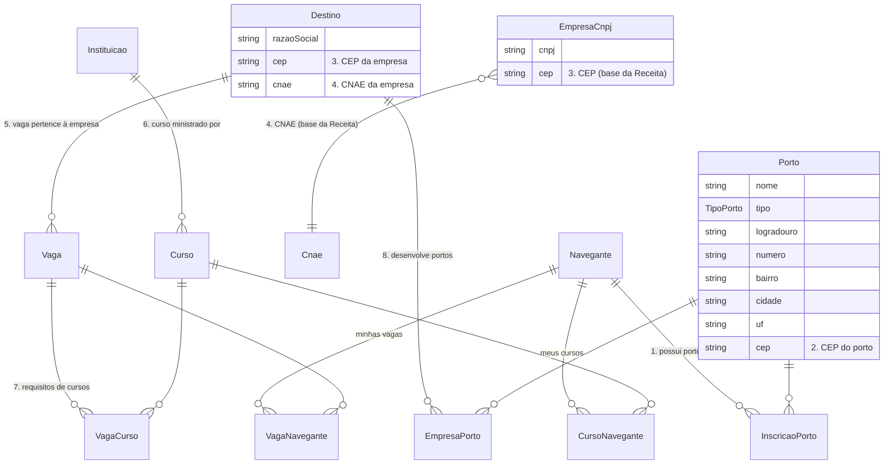

# Relações do painel "Meus portos"

Estrutura pedida em `Meus portos.docx` ("Sistema de Matching", itens 1 a 8), como ela existe no banco
(`prisma/schema.prisma`).

| # | Regra | Como está no banco |
|---|---|---|
| 1 | Uma pessoa pode possuir zero ou mais portos | `Navegante` 1—N `InscricaoPorto` N—1 `Porto` |
| 2 | O porto possui um CEP | `Porto.cep` (+ `latitude`/`longitude`) |
| 3 | A empresa está localizada em um CEP | `Destino.cep` (empresa da plataforma) · `EmpresaCnpj.cep` (base da Receita) |
| 4 | Uma empresa possui um CNAE | `Destino.cnae` · `EmpresaCnpj.cnaeCodigo` → `Cnae` |
| 5 | Uma vaga pertence a uma empresa | `Vaga.destinoId` → `Destino` |
| 6 | Um curso é ministrado por uma empresa | `Curso.instituicaoId` → `Instituicao` (instituição educadora) |
| 7 | Uma vaga pode possuir 0 ou mais requisitos de cursos | `Vaga` N—N `Curso` via `VagaCurso` |
| 8 | Uma empresa pode desenvolver 0 ou mais portos | `Destino` N—N `Porto` via `EmpresaPorto` |

Escolhas do Navegante no painel:

- **Minhas vagas** — `Navegante` N—N `Vaga` via `VagaNavegante`
- **Meus cursos** — `Navegante` N—N `Curso` via `CursoNavegante`

## Matching (`src/lib/matching.ts`)

- **Compatibilidade com o Ethos**: % dos valores que o Navegante marcou na Q4.1 ("O que você mais valoriza")
  que a vaga/curso também declara em `valoresEthos` (mesmas opções da Q4.1).
- **Proximidade com os portos**: menor distância entre o local da vaga/curso e os portos do Navegante.
  A vaga usa a coordenada própria ou, na falta, a da empresa.
- **Nota da vaga** (0–100): Ethos 50% · proximidade 35% · cursos exigidos que a pessoa já escolheu 15%.
- **Nota do curso** (0–100): compatibilidade com vagas 40% (exigido por uma das minhas vagas = total;
  por alguma vaga da plataforma = metade) · Ethos 30% · proximidade 30% (curso remoto conta como próximo).
- **"Todas as vagas/cursos de todos os portos"**: tudo o que fica a até 15 km de algum porto (e cursos remotos).

## [Matching-Navegante] e painel de Vagas (`src/lib/matching-navegante.ts`)

Regras de `matchingVagas.docx`:

- **Perfil JSON** (`MatchingNavegante.perfil`): valores (Q4.1), ambientes (Q7.3), profissão (Q7.1) e escolaridade (Q1.9)
  do Ethos; portos inscritos (CEP e coordenadas); cursos escolhidos e cursos realizados.
- **Quando é gravado**: depois de salvar um bloco do Ethos, mudar portos ou incluir/editar/excluir/escolher cursos.
  A `assinatura` (SHA-256 do JSON) evita regravar quando nada mudou.
- **Vagas do painel**: vagas ativas de empresas a até 15 km dos portos do Navegante (todas, se ele não tem portos),
  da mais para a menos compatível.
- **Índice de compatibilidade** (0–100): Ethos 35% · proximidade da empresa aos portos 30% ·
  CNAEs da empresa (principal e secundários, da consulta do CNPJ) × ambientes da Q7.3 20% (`DIVISOES_CNAE_POR_AMBIENTE`) · cursos exigidos já feitos ou escolhidos 15%.
- Campos da vaga em branco não aparecem.

## Cursos publicados por empresas e painel de Cursos (`publicacaoCursos.docx`)

- **[Especificacao-Curso]** (`src/lib/curso-spec.ts`): curso, descrição/conteúdo, carga horária, instituição de ensino,
  data de realização e modalidade (Presencial → `PRESENCIAL`, Online → `REMOTA`, Ambos → `HIBRIDA`). Vale para os
  cursos realizados do Navegante e para os cursos publicados pelas empresas.
- **Empresa publica cursos**: `Curso.destinoId` (a empresa) + `Curso.instituicaoEnsino` (nome informado). Cursos de
  instituições continuam em `Curso.instituicaoId`. Presencial/Ambos usam o endereço da empresa.
- **Painel Cursos do Navegante**: cursos ligados às 5 vagas de maior matching — exigidos por elas ou publicados pelas
  empresas delas —, ordenados pelo índice da vaga. Cursos que o Navegante já realizou não aparecem.

## [Matching-Empresa] (`src/lib/matching-empresa.ts`)

- **Perfil JSON** (`MatchingEmpresa.perfil`): razão social, CNPJ, CNAEs (principal e secundários) e os ambientes da
  Q7.3 que combinam com eles; local (CEP e coordenadas); portos que a empresa desenvolve e portos a até 15 km;
  vagas ativas com os cursos exigidos e os 5 cursos mais compatíveis; cursos publicados com as vagas que mais combinam.
- **Nota curso × vaga** (0–100): exigido pela vaga = 100; senão valores do Ethos em comum 60% · proximidade 25%
  (online conta como próximo) · curso da própria empresa 15%.
- **Quando é gravado**: ao salvar os dados da empresa e também ao publicar/remover vagas e cursos ou mudar os portos
  que desenvolve. A `assinatura` (SHA-256 do JSON) evita regravar quando nada mudou.

## Indicadores do NAVIRA (`src/lib/indicadores/`)

Regras de `NAVIRA-EmNumeros.docx`, `NAVIRA-ImpactScore-IndiceInclusaoProdutiva.docx` e
`NAVIRA-ImpactScore-IndiceDesenvolvimentoTerritorial.docx`. Os cálculos são funções puras sobre `BaseIndicadores`;
só `carregar.ts` lê o banco. Entrada única: `gerarIndicadores(prisma, periodo)` (padrão: últimos 12 meses).

Novos no banco (`prisma/indicadores.prisma`):

- **`Contratacao`** — `Navegante` N—1, `Destino` N—1, `Vaga` N—0..1; início, fim (null = ainda trabalhando),
  salário e local. Vaga preenchida = vaga com contratação.
- **`MunicipioPrioritario`** — nome, UF, código IBGE e população economicamente ativa (PEA).
- **`Navegante`** + `salarioInicial`, `ultimaAtividadeEm`, `genero`, `racaCor`, `pcd`, `moraEmPeriferia`, `dataNascimento`.
- **`Destino`** + `cidade`/`uf` (pela consulta do CEP). **`VagaNavegante`** + `status` (`StatusCandidatura`).
- Município = `cidade/UF` normalizado (`municipioChave`). O do Navegante vem dos portos em que está inscrito.

### Navira em Números (`em-numeros.ts`)

- **Pessoas cadastradas** e **ativas** (atividade nos últimos 90 dias).
- **Vagas publicadas** e **preenchidas** no período.
- **Aumento médio de renda**: salário atual (contratação vigente mais recente; senão a última) − `salarioInicial`.
- **Tempo para dobrar a renda**: meses do cadastro até a primeira contratação com salário ≥ 2× o inicial (média e mediana).
- **Curso/trilha que gera mais renda**: aumento médio de quem concluiu cada curso realizado (mínimo de 3 pessoas).
- **Município que gera mais oportunidades**: vagas publicadas no período (desempate: contratações).

### Índice de Inclusão Produtiva — IIP (`inclusao-produtiva.ts`), 30% do Impact Score

- Etapas: **cadastradas** · **acessadas** (vaga com status `CANDIDATADA` ou além, ou contratada) · **contratadas** no período.
- Tabela por categoria (Gênero/mulheres, Raça/negros e indígenas, PCD, Especial/periferia, Idade ≤ 24 ou ≥ 50, Total):
  absoluto e % da etapa, e conversão contratadas ÷ acessadas.
- **Índice** (0–100) = 30% · % diversos entre cadastradas + 35% · entre acessadas + 35% · entre contratadas
  (pessoa diversa = ao menos uma categoria).
- **Equidade de contratação**: diversos contratados ÷ contratados; paridade = % diversos contratados ÷ % diversos cadastrados.

### Índice de Desenvolvimento Territorial — IDT (`desenvolvimento-territorial.ts`), 20% do Impact Score

- **Impacto territorial** (por município): vagas, renda média, empresas participantes e cursos concluídos no período
  × período anterior de mesma duração.
- **Cobertura territorial**: municípios prioritários com vaga, contratação ou curso concluído ÷ municípios prioritários.
  Cada município traz `intensidade` para o mapa de calor e a listagem de cidades.
- **Taxa de conexão local**: contratações em município de algum porto da pessoa ÷ total de contratações.
- **Retenção territorial**: pessoas inseridas no período que seguem trabalhando no município da primeira contratação ÷ inseridas.
- **Parceria estruturante**: empresas que apadrinham ao menos um porto (`EmpresaPorto`).
- **Densidade de oportunidades**: vagas do período por mil pessoas da PEA do município.
- **Índice** (0–100) = 30% cobertura · 40% conexão local · 20% retenção, normalizado pela soma (90%).

### Navira Impact Score (`impact-score.ts`)

- IIP 30% + IDT 20%. Os outros 50% ainda não foram especificados: `scoreParcial` é a média ponderada dos dois,
  em 0–100, e `cobertura` = 0,5.
